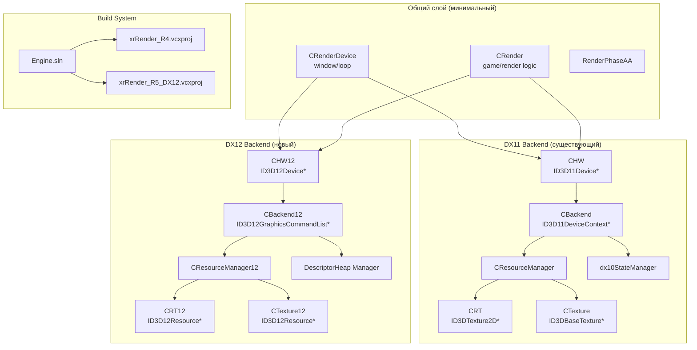

# DX12 Architecture Design ADR — OGSR-Engine RTX

## 1. Status / Context

| Поле | Значение |
|---|---|
| Статус | **Draft → Proposed** |
| Этап | F1 (архитектурное проектирование) |
| Ветка | `prypiat` |
| Предшествующий документ | `docs/dx12-port-audit.md` (F0, коммит `b396cfb42`) |
| Дата | 2026-10-14 |
| Изменения кода | **Отсутствуют** — только документация |

**Контекст:** Движок OGSR-Engine (форк X-Ray для CoP) — чистый DirectX 11.
Этап F0 подтвердил, что прямой перенос невозможен: D3D11-типы пронизывают
все классы рендерера. Цель F1 — спроектировать архитектуру параллельного
DX12 backend, который можно внедрить инкрементально, не разрушая рабочий
DX11 renderer.

---

## 2. Existing Architecture (Verified)

### 2.1 Компоновка модулей

```
Engine.sln (26 проектов)
├── xrRender_R4 (StaticLib)
│   ├── xrRenderPC_R4/*.cpp
│   ├── xrRender/*.cpp
│   └── xrRenderDX10/*.cpp
├── xrGame (StaticLib)
├── xr_3DA (Application → xrEngine.exe)
└── ...
```

**Verified:** `Engine.sln:1-247`; `xrRender_R4.vcxproj` собирает исходники
из трёх каталогов в одну статическую библиотеку.

### 2.2 Глобальные синглтоны

| Объект | Файл:строка | Тип |
|---|---|---|
| `HW` | `dx10HW.cpp:25` | `CHW` (D3D11 device) |
| `RImplementation` | `r4.h:469` | `CRender` (renderer) |
| `Device` | `device.cpp:19` | `CRenderDevice` (window/loop) |

**Verified:** Все три — глобальные синглтоны с статическим временем жизни.

### 2.3 Цикл кадра

```
CRenderDevice::Run()          device.cpp:417
  → Begin()                   device.cpp:32
    → m_pRender->GetDeviceState()
    → ::Render->Begin()
  → CRender::Render()         r4_R_render.cpp:266-536
    → phase_combine()         r4_rendertarget_phase_combine.cpp:8-378
  → End()                     device.cpp:64
  → Present
```

**Verified:** `device.cpp:32-60`, `device.cpp:64-80`.

### 2.4 CHW (D3D11 Device)

| Поле | Тип | Файл:строка |
|---|---|---|
| `pDevice` | `ID3D11Device*` | `HW.h:36` |
| `m_pSwapChain` | `IDXGISwapChain2*` | `HW.h:40` |
| `d3d_contexts_pool[10]` | `ID3D11DeviceContext*[10]` | `HW.h:78` |
| `m_pFactory` | `IDXGIFactory1*` | `HW.h:38` |
| `m_pAdapter` | `IDXGIAdapter1*` | `HW.h:39` |

**Verified:** `HW.h:13-83`; создание устройства — `dx10HW.cpp:148-274`.

### 2.5 CBackend (Command Processor)

| Поле | Тип | Файл:строка |
|---|---|---|
| `pRT[4]` | `ID3DRenderTargetView*[4]` | `R_Backend.h:102` |
| `pZB` | `ID3DDepthStencilView*` | `R_Backend.h:103` |
| `vb` | `ID3DVertexBuffer*` | `R_Backend.h:107` |
| `ib` | `ID3DIndexBuffer*` | `R_Backend.h:108` |
| `ps/vs/gs/hs/ds/cs` | `ID3D{Vertex,Pixel,Geometry,Hull,Domain,Compute}Shader*` | `R_Backend.h:117-122` |
| `state` | `ID3DState*` | `R_Backend.h:116` |

**Verified:** `R_Backend.h:74-665`.

### 2.6 Ресурсы

| Класс | D3D11-типы | Файл:строка |
|---|---|---|
| `CRT` | `ID3DTexture2D*`, `ID3DRenderTargetView*`, `ID3DDepthStencilView*`, `ID3D11UnorderedAccessView*` | `SH_RT.h:4-54` |
| `CTexture` | `ID3DBaseTexture*`, `ID3DShaderResourceView*` | `SH_Texture.h:9-135` |
| `dx10ConstantBuffer` | `ID3D11Buffer*` | `ResourceManager.h:114` |

### 2.7 State Management

`dx10StateManager` кэширует:
- `ID3DRasterizerState*` — `dx10StateManager.h:54`
- `ID3DDepthStencilState*` — `dx10StateManager.h:55`
- `ID3DBlendState*` — `dx10StateManager.h:56`

### 2.8 Шейдеры

| Метод | Тип возвращаемого | Файл:строка |
|---|---|---|
| `ShaderTypeTraits<SHS>::CreateHWShader` | `ID3D11HullShader*` | `ShaderResourceTraits.h:13-25` |
| `ShaderTypeTraits<SDS>::CreateHWShader` | `ID3D11DomainShader*` | `ShaderResourceTraits.h:28-44` |
| `ShaderTypeTraits<SCS>::CreateHWShader` | `ID3D11ComputeShader*` | `ShaderResourceTraits.h:47-63` |
| `ShaderTypeTraits<SGS>::CreateHWShader` | `ID3DGeometryShader*` | `ShaderResourceTraits.h:66-80` |

Все используют `HW.pDevice->Create*Shader(...)` — жёсткая привязка к D3D11.

---

## 3. Architectural Goals

1. **Сохранить рабочий DX11 renderer** как baseline и способ отката.
2. **Внести DX12 инкрементально** через параллельный backend.
3. **Минимальная архитектура** — без универсального RHI и абстракций ради абстракций.
4. **Проверяемые вертикальные срезы** — каждый этап F2-F5 имеет критерии приёмки.
5. **DXR-ready** — архитектура совместима с будущей аппаратной трассировкой.

---

## 4. Non-goals

1. Полная замена DX11 одним коммитом.
2. Переписывание всех 424 HLSL-файлов на SM6.
3. Универсальный render graph.
4. Поддержка Vulkan/Metal.
5. Пользовательский runtime toggle DX11/DX12 на ранних этапах.
6. Массовый рефакторинг игровой логики.

---

## 5. Constraints from F0

| Ограничение | Источник |
|---|---|
| `xrRender_R4` собирает 3 каталога в 1 StaticLib | `Engine.sln` |
| `CHW`/`CBackend`/`CResourceManager` содержат D3D11-типы | F0 §2 |
| `RenderFactory` — не RHI | F0 §1 |
| 424 HLSL (SM 5.0/DXBC) | F0 §4 |
| `D3DVERTEXELEMENT9` (D3D9 legacy) в `tss_def.cpp` | F0 §2.2 |
| 64 RT с собственными дескрипторами | F0 §2.4 |
| 10 D3D11 contexts (9 deferred + 1 immediate) | `HW.h:78` |

---

## 6. Alternatives Considered

### Вариант A: Полная замена CHW/CBackend

**Описание:** Переписать `CHW` → `CHW12`, `CBackend` → `CBackend12`,
`CResourceManager` → `CResourceManager12` в одном коммите.

**Риск:** Критический. Нет откатa. Невозможно тестировать поэтапно.
Все 64 RT, 424 шейдера, 10 контекстов — всё ломается разом.

**Verdict:** Отклонено.

### Вариант B: Параллельный DX12-путь (рекомендуется)

**Описание:** Создать параллельные классы `CHW12`, `CBackend12`,
`CResourceManager12` рядом с существующими. Переключение через build-time
флаг. DX11 остаётся основным путём.

**Риск:** Высокий, но управляемый. Можно тестировать поэтапно.
DX11 baseline не ломается.

**Verdict:** **Принято.**

### Вариант C: DX12 только для DXR

**Описание:** DX12 только для compute/DXR проходов, растр остаётся на D3D11.
Общие ресурсы через shared handles.

**Риск:** Средний. Сложная интеграция: два GPU API в одном кадре.

**Verdict:** Отложено как возможная оптимизация после F4.

### Вариант D: Compute-трассировка на DX11

**Описание:** `cs_5_0` + DDA без DX12. Это этап D дорожной карты.

**Риск:** Средний. Ограничения screen-space.

**Verdict:** Параллельно с B (compute-гейт B2.0/D0 — оба требуют
минимальный `Dispatch` + UAV).

---

## 7. Decision and Rationale

### 7.1 Выбранный вариант: B (параллельный DX12-путь)

**Обоснование:**

1. **Сохранение DX11 baseline** — рабочая игра не ломается.
2. **Инкрементальность** — каждый вертикальный срез проверяем.
3. **Откат** — build-time флаг возвращает к DX11.
4. **DXR-ready** — DX12 в конечном счёте нужен для DXR.

### 7.2 Ключевые архитектурные решения

| # | Решение | Обоснование |
|---|---|---|
| D1 | Параллельные классы, не замена | Минимальный радиус регрессий |
| D2 | Build-time переключение | Нет пользовательского toggle до F4/F5 |
| D3 | Минимальный CHW12 | Только device + queue + swapchain + fences |
| D4 | Одна graphics queue | Async compute — будущая оптимизация |
| D5 | 2-3 frame resources | Баланс latency/throughput |
| D6 | Новый `.vcxproj` для DX12 | Раздельная компиляция, раздельные зависимости |
| D7 | DXBC для raster, DXIL для DXR | Совместимость с существующими 424 шейдерами |
| D8 | Общий оконный цикл | `CRenderDevice` остаётся |

---

## 8. Proposed Module Boundaries

### 8.1 Диаграмма зависимимостей



### 8.2 Граница API

| Слой | DX11 | DX12 | Общий? |
|---|---|---|---|
| Device | `CHW` | `CHW12` | Нет |
| Command List | `CBackend` | `CBackend12` | Нет |
| Resources | `CResourceManager` | `CResourceManager12` | Нет |
| State | `dx10StateManager` | PSO cache | Нет |
| Window/Loop | `CRenderDevice` | `CRenderDevice` | **Да** |
| Frame Logic | `CRender` | `CRender12` | **Нет** |
| Post-processing | `RenderPhaseAA` | `RenderPhaseAA12` | Нет |
| Shaders | `r4.cpp` (D3DCompile) | `r4_12.cpp` (DXC) | Нет |

**Decision:** Общий слой — только `CRenderDevice` (оконный цикл). `CRender`
не может быть общим: содержит `contexts_pool[10]` (`R_dsgraph_structure`
с `CBackend`), `nVB/xVB` (`ID3DVertexBuffer*`), `nIB/xIB` (`ID3DIndexBuffer*`),
прямые вызовы `HW` (глобальный `CHW`). Для DX12 нужен отдельный `CRender12`.

---

## 9. Device & Swapchain Contract

### 9.1 CHW12 (архитектурный псевдокод)

```cpp
class CHW12
{
public:
    // --- Device ---
    ID3D12Device*           device;           // Владелец: CHW12
    IDXGIFactory4*          factory;          // Владелец: CHW12
    IDXGIAdapter3*          adapter;          // Владелец: CHW12

    // --- Queues ---
    ID3D12CommandQueue*     graphics_queue;    // Владелец: CHW12
    // ID3D12CommandQueue*  compute_queue;    // Deferred: F5+

    // --- Swapchain ---
    IDXGISwapChain4*        swapchain;        // Владелец: CHW12
    static constexpr u32    FRAME_COUNT = 3;  // 2-3 frame resources

    // --- Frame resources ---
    struct FrameResource
    {
        ID3D12CommandAllocator* allocator;    // Владелец: CHW12
        ID3D12Resource*         backbuffer;   // Владелец: CHW12
        u64                     fence_value;  // CPU-side
    };
    FrameResource           frames[FRAME_COUNT];

    // --- Descriptors ---
    ID3D12DescriptorHeap*   rtv_heap;         // Владелец: CHW12
    ID3D12DescriptorHeap*   dsv_heap;         // Владелец: CHW12
    ID3D12DescriptorHeap*   cbv_srv_uav_heap; // Владелец: CHW12

    // --- Synchronization ---
    ID3D12Fence*            fence;            // Владелец: CHW12
    HANDLE                  fence_event;      // Владелец: CHW12
    u64                     fence_value;      // CPU-side counter

    // --- State ---
    u32                     frame_index;      // Текущий backbuffer
    u32                     render_width;     // Рендер-разрешение
    u32                     display_width;    // Разрешение окна
    bool                    fullscreen;
    bool                    allow_tearing;

    // --- Methods ---
    bool Initialize(HWND hwnd, u32 width, u32 height);
    void Shutdown();
    void Resize(u32 width, u32 height);
    void WaitForGpu();
    void MoveToNextFrame();
    bool Present(bool vsync);
};
```

### 9.2 Swapchain Lifecycle

```
Initialize:
  CreateDXGIFactory4 → EnumAdapterByGpuPreference(HIGH_PERFORMANCE)
  → D3D12CreateDevice → CheckFeatureSupport(D3D12_FEATURE_D3D12_OPTIONS)
  → CreateCommandQueue(DIRECT) → CreateSwapChainForHwnd(3 buffers)
  → CreateDescriptorHeaps(RTV, DSV, CBV_SRV_UAV)
  → CreateCommandAllocators[3] → CreateFence → CreateEvent

Per Frame:
  MoveToNextFrame → WaitForFence(frames[idx].fence_value)
  → ResetAllocator → BeginCommandRecording
  → ... render ...
  → Barrier(RENDER_TARGET → PRESENT)
  → EndCommandRecording → ExecuteCommandLists
  → Present(1) → Signal(fence, ++fence_value)

Resize:
  WaitForGpu → ReleaseBackbuffers
  → SwapChain->ResizeBuffers → RecreateRTVs
  → UpdateViewport/Scissor

Shutdown:
  WaitForGpu → Release all
```

**Decision:** `FRAME_COUNT = 3` — баланс latency/throughput. Можно
переключить на 2 для меньшей latency.

### 9.3 Resource Transitions

Каждый `ID3D12Resource` имеет текущее состояние. Переходы:

```cpp
struct ResourceBarrier
{
    ID3D12Resource* resource;
    D3D12_RESOURCE_STATES before;
    D3D12_RESOURCE_STATES after;
};

void Transition(ID3D12GraphicsCommandList* cmd,
                std::initializer_list<ResourceBarrier> barriers);
```

**Decision:** Явные barriers в command list. Не использовать implicit
transition (D3D11-style).

---

## 10. Command Recording & Synchronization

### 10.1 CBackend12 (архитектурный псевдокод)

```cpp
class CBackend12
{
public:
    ID3D12GraphicsCommandList*  cmd_list;        // Владелец: CHW12 (per-frame)

    // --- Pipeline State ---
    ID3D12PipelineState*        pso;             // Кэш: PSOCache
    ID3D12RootSignature*        root_sig;        // Кэш: RootSignatureCache

    // --- Bindings ---
    D3D12_CPU_DESCRIPTOR_HANDLE rtvs[4];        // Указатели на дескрипторы
    D3D12_CPU_DESCRIPTOR_HANDLE dsv;
    D3D12_VERTEX_BUFFER_VIEW    vbv;
    D3D12_INDEX_BUFFER_VIEW     ibv;

    // --- Methods ---
    void SetPipelineState(ID3D12PipelineState* pso);
    void SetRootSignature(ID3D12RootSignature* sig);
    void SetRenderTargets(u32 count, D3D12_CPU_DESCRIPTOR_HANDLE* rtvs,
                          D3D12_CPU_DESCRIPTOR_HANDLE dsv);
    void SetVertexBuffer(D3D12_VERTEX_BUFFER_VIEW vbv);
    void SetIndexBuffer(D3D12_INDEX_BUFFER_VIEW ibv);
    void SetRootConstants(u32 param, u32 count, const void* data);
    void SetRootDescriptorTable(u32 param, D3D12_GPU_DESCRIPTOR_HANDLE handle);
    void Draw(u32 vtx_count, u32 inst_count, u32 vtx_offset, u32 inst_offset);
    void DrawIndexed(u32 idx_count, u32 inst_count, u32 idx_offset, u32 base_vtx, u32 inst_offset);
    void Dispatch(u32 x, u32 y, u32 z);
    void TransitionBarrier(ID3D12Resource* res, D3D12_RESOURCE_STATES before, D3D12_RESOURCE_STATES after);
};
```

### 10.2 Модель синхронизации

```
CPU (Render Thread)          GPU
─────────────────────────────────────────────
  ResetAllocator()
  BeginCommandRecording()
  Record draw calls ...
  ExecuteCommandLists()  ──→  Graphics Queue
  Signal(fence, N)              ...
                               WaitForFence(N) ←──
  Present()
  MoveToNextFrame()
  WaitForFence(frames[idx].fence_value)
```

**Verified:** D3D11 использует неявную синхронизацию (драйвер). В D3D12
нужны явные `ID3D12Fence` и `WaitForFence`.

### 10.3 Отношение к 10 D3D11-контекстам

**Decision:** Не копировать архитектуру 10 контекстов. В D3D12 — 1 command
list per frame (3 в flight). 9 deferred contexts D3D11 используются для
параллельной геометрии (particles, bones, sectors). В D3D12 это можно
делать через:
- несколько command lists, записываемых из worker threads (F5+)
- или один command list с последовательной записью (F2-F4)

**Deferred:** Окончательное решение по worker threads — после F2 замеров.

---

## 11. GPU Resources & Descriptors

### 11.1 Различия понятий

| Понятие | Описание |
|---|---|
| `ID3D12Resource` | GPU-ресурс (текстура, buffer) |
| View | Логическое представление ресурса (SRV, UAV, RTV, DSV) |
| Descriptor | CPU-side структура, описывающая view для GPU. Не COM-объект. |
| Descriptor Heap | Массив дескрипторов в GPU-видимой памяти |
| GPU Virtual Address | Адрес ресурса в GPU-памяти |

**Важно:** В D3D12 нет `ID3D12ShaderResourceView` как COM-объекта. Есть
`D3D12_SHADER_RESOURCE_VIEW_DESC` — структура, которая хранится в
descriptor heap и интерпретируется GPU. Descriptor — это не COM-объект,
это блок памяти фиксированного размера.

### 11.2 Интерфейсы

```cpp
// Простой wrapper для ID3D12Resource
class CResource12
{
public:
    ID3D12Resource*           resource;        // Владелец: CResource12
    D3D12_RESOURCE_STATES     state;
    u32                       width, height;
    DXGI_FORMAT               format;
};

// Текстура
class CTexture12 : public CResource12
{
public:
    D3D12_SHADER_RESOURCE_VIEW_DESC srv_desc;
    D3D12_UNORDERED_ACCESS_VIEW_DESC uav_desc;
};

// Render target
class CRT12 : public CResource12
{
public:
    D3D12_RENDER_TARGET_VIEW_DESC rtv_desc;
    D3D12_DEPTH_STENCIL_VIEW_DESC dsv_desc;
};

// Descriptor Heap Manager
class CDescriptorHeap12
{
public:
    ID3D12DescriptorHeap* heap;
    u32                   descriptor_size;
    u32                   capacity;
    u32                   used;

    D3D12_CPU_DESCRIPTOR_HANDLE Allocate();
    void Free(D3D12_CPU_DESCRIPTOR_HANDLE handle);
};
```

### 11.3 Deferred Destruction

```cpp
// Очередь уничтожения для безопасного освобождения после GPU
struct DeferredRelease
{
    ID3D12Resource* resource;
    u64             frame_fence_value;
};

std::vector<DeferredRelease> deferred_releases;

void ReleaseWhenSafe(ID3D12Resource* resource, u64 fence_value);
void ProcessDeferredReleases(u64 completed_fence_value);
```

**Decision:** Простая реализация — `std::vector` + `std::remove_if`.
Для первого работающего пути достаточно. Аллокаторы — F5+.

---

## 12. Shader Compiler & PSO

### 12.1 Два пути компиляции

| Путь | Компилятор | Формат | SM | Когда |
|---|---|---|---|---|
| Raster | `D3DCompile` (d3dcompiler.lib) | DXBC | 5.0 | Существующие 424 HLSL |
| DXR | `dxcompiler.lib` (DXC) | DXIL | 6.x | Только трассировочные шейдеры |

**Decision:** Совместное существование двух путей. Не порировать все
424 HLSL на SM6.

### 12.2 PSO Cache

```cpp
class PSOCache12
{
public:
    struct PSOKey
    {
        // Hash из всех полей D3D12_GRAPHICS_PIPELINE_STATE_DESC:
        // - shader bytecode (VS/PS/GS/HS/DS)
        // - root signature
        // - input layout (D3D12_INPUT_ELEMENT_DESC)
        // - blend state (D3D12_BLEND_DESC)
        // - rasterizer state (D3D12_RASTERIZER_DESC)
        // - depth-stencil state (D3D12_DEPTH_STENCIL_DESC)
        // - primitive topology type (D3D12_PRIMITIVE_TOPOLOGY_TYPE)
        // - render target count
        // - RTV formats[]
        // - DSV format
        // - sample description (count, quality)
        // - sample mask
        // - cached PSO blob (optional)
    };

    ID3D12PipelineState* GetOrCreate(const PSOKey& key, const PSODesc& desc);
    void Clear();

private:
    std::unordered_map<u64, ID3D12PipelineState*> cache;
};
```

**Decision:** PSO key должен включать все поля, влияющие на совместимость
pipeline. Неполный ключ приводит к ошибкам рендера или validation errors.

### 12.3 Root Signature

```cpp
class RootSignatureCache12
{
public:
    struct RootSigKey
    {
        // Hash из:
        // - количества root parameters
        // - типов (CBV, SRV, UAV, constants)
        // - samplerов
    };

    ID3D12RootSignature* GetOrCreate(const RootSigKey& key, const RootSigDesc& desc);
    void Clear();

private:
    std::unordered_map<u64, ID3D12RootSignature*> cache;
};
```

### 12.4 Shader Cache Key

Текущий кэш в `r4.cpp:823-869` использует CRC32. Для DX12 ключ должен
включать:
- путь к шейдеру + CRC32 содержимого
- defines (`m_ShaderOptions`, `r4.h:356`)
- тип компиляции (DXBC vs DXIL)
- целевая платформа (SM 5.0 vs 6.x)

---

## 13. ABI / Ownership / Lifetime

### 13.1 Правила владения

| Объект | Владелец | Время жизни |
|---|---|---|
| `CHW12` | `Device` | С момента `Initialize()` до `Shutdown()` |
| `ID3D12Device` | `CHW12` | С момента создания до уничтожения `CHW12` |
| `ID3D12CommandQueue` | `CHW12` | Постоянно |
| `IDXGISwapChain4` | `CHW12` | Постоянно |
| `FrameResource` | `CHW12` | Постоянно |
| `ID3D12CommandAllocator` | `CHW12::FrameResource` | Постоянно |
| `ID3D12DescriptorHeap` | `CHW12` | Постоянно |
| `CBackend12` | `CRender` | Постоянно |
| `ID3D12GraphicsCommandList` | `CHW12::FrameResource` | Постоянно |
| `CResource12` | `CResourceManager12` | Постоянно |

### 13.2 Правила уничтожения

1. `WaitForGpu()` перед любым освобождением.
2. Сначала release command lists и allocators.
3. Потом — swapchain buffers и дескрипторы.
4. Потом — device и factory.

### 13.3 Правила ABI

- D3D12-типы **не проникают** в общие заголовки (`device.h`, `r4.h`).
- Общие заголовки — только API-независимые типы (`Fmatrix`, `Fvector` и т.д.).
- DX12-специфичные типы — в отдельных заголовках в `xrRenderDX12/`.

---

## 14. Build Configuration & Rollback

### 14.1 Новый проект

```
xrRender_R5_DX12.vcxproj → xrRender_R5_DX12.lib
├── xrRenderDX12/
│   ├── CHW12.cpp
│   ├── CBackend12.cpp
│   ├── CResourceManager12.cpp
│   ├── CRT12.cpp
│   ├── CTexture12.cpp
│   ├── dx12StateManager.cpp
│   ├── dx12ResourceManager_Resources.cpp
│   ├── dx12SH_RT.cpp
│   └── ...
├── xrRenderPC_R5_DX12/
│   ├── r5.cpp
│   ├── r5_R_render.cpp
│   └── ...
```

### 14.2 Переключение backend

```cmd
:: DX11 (default)
msbuild Engine.sln /p:Configuration=Release /p:Platform=x64

:: DX12 (experimental)
msbuild Engine.sln /p:Configuration=ReleaseDX12 /p:Platform=x64
```

**Decision:** Build-time конфигурация `ReleaseDX12`. DX11 `Release` остаётся
основным путём.

### 14.3 Rollback

Для отката к DX11:
1. Выбрать `Release|x64` конфигурацию.
2. Собрать исходный DX11 target.
3. Убедиться, что старый renderer загружается.
4. Не использовать экспериментальные DX12-бинарники.

**Не нужно удалять `xrRender_R5_DX12` из `Engine.sln`** — проект просто не
участвует в сборке `Release`. Rollback воспроизводим без ручного
удаления проектов или исходников.

---

## 15. DX11/DX12 Compatibility Rules

### 15.1 Запрещено

1. D3D12-типы в `xrRender/`, `xrRenderPC_R4/`, `xr_3da/`.
2. Изменение существующих D3D11-классов.
3. Пользовательский toggle DX11/DX12 до F4/F5.
4. Одновременная линковка D3D11 и D3D12 в одном проекте до F4.

### 15.2 Разрешено

1. Новые классы в `xrRenderDX12/`, `xrRenderPC_R5_DX12/`.
2. Общие API-независимые интерфейсы.
3. Build-time переключение конфигурации.

---

## 16. DXR Readiness

### 16.1 Архитектурные требования

| Требование | Статус в ADR |
|---|---|
| `D3D12_FEATURE_D3D12_OPTIONS5` check | Deferred (G0) |
| BLAS/TLAS | Deferred (G1) |
| Geometry extraction | Deferred (G1) |
| DXC/DXIL для трассировочных шейдеров | Deferred (G2) |
| Shader Binding Table | Deferred (G2) |
| `DispatchRays` | Deferred (G2) |

### 16.2 Совместимость с G-buffer

**Verified:** G-buffer содержит:
- `rt_Position.xy` — нормали (закодированы)
- `rt_Position.z` — view-space Z
- `rt_Position.w` — material ID + hemi
- `rt_Color.a` — gloss

**Decision:** Для DXR нужен способ получать свойства **попавшей**
поверхности, в том числе вне экрана. Это отдельная задача G1.

---

## 17. Integration Risks

### 17.1 DLSS/FSR3

**Verified:** `RenderTargetPhaseAA.cpp` использует:
- `NGXWrapper` — `ID3D11Device*`, `ID3D11DeviceContext*`, `NVSDK_NGX_*`
- `Fsr3Wrapper` — `ffxFsr3Upscaler*` (DX11-специфичный бэкенд)

**Decision:** Для DX12 нужны отдельные обёртки `NGXWrapper12` и
`Fsr3Wrapper12`. Это этап F5.

### 17.2 ImGui

**Verified:** `dx10HW.cpp:15-18` включает `imgui_impl_dx11.h` и
`imgui_impl_win32.h`.

**Decision:** Для DX12 нужен `imgui_impl_dx12.h` + `imgui_impl_win32.h`.
Это этап F5.

### 17.3 Tracy

**Verified:** `HW.h:49` — `TracyD3D11Ctx profiler_ctx`.

**Decision:** Для DX12 нужен `TracyD3D12Ctx`. Это этап F5.

### 17.4 RenderDoc

**Verified:** `dxRenderDeviceRender.cpp:6-11` — `g_renderdoc_api`.

**Decision:** RenderDoc поддерживает DX12 через тот же API. Должно работать
без изменений. Проверка — F5.

### 17.5 ReShade

**Verified:** `xr_3da/ReShadeCompat.cpp` — отдельный слой.

**Decision:** ReShade поддерживает DX12. Интеграция — F5.

### 17.6 Render Threads

**Verified:** `r4.h:188-192` — `particles_pool`, `light_pool` (worker threads).

**Decision:** Для DX12 command lists из worker threads нужна синхронизация.
Это F5+. До F4 — один command list из render thread.

### 17.7 Resize

**Verified:** `dxRenderDeviceRender.cpp:70-92` — `Reset()` вызывает
`HW.ResetDevice(hWnd)`.

**Decision:** Для DX12 resize требует: `WaitForGpu()` → release →
`ResizeBuffers` → recreate RTVs. Это F5.

---

## 18. F2–F5 Implementation Plan

### F2 — DX12 Bootstrap

| Поле | Значение |
|---|---|
| Зависимости | F1 ADR |
| Изменения | `xrRenderDX12/CHW12.cpp` — device, queue, swapchain, fences, clear, present |
| Артефакт | Окно с цветной заливкой, стабильный 60 FPS |
| Критерии | `Clear → Present` без validation errors; resize работает; device removed обрабатывается |
| Риски | Swapchain sync, fence timing |
| Rollback | Вернуть `Release` конфигурацию |
| Блокировать переход | Validation errors, device lost при нормальных условиях |

### F3 — Basic Raster

| Поле | Значение |
|---|---|
| Зависимости | F2 |
| Изменения | `CBackend12.cpp`, `CResourceManager12.cpp`, `CRT12.cpp`, `CTexture12.cpp` |
| Артефакт | Текстурированный треугольник с depth test |
| Критерии | Корректный треугольник, depth test, camera movement |
| Риски | Root signature, PSO, input layout |
| Rollback | Убрать `xrRender_R5_DX12` из SLN |
| Блокировать переход | GPU faults, leaks, некорректный raster |

### F4 — OGSR Integration

| Поле | Значение |
|---|---|
| Зависимости | F3 |
| Изменения | `xrRenderPC_R5_DX12/r5.cpp`, `r5_R_render.cpp` — перенос основных проходов |
| Артефакт | Игровая локация на DX12 |
| Критерии | Та же локация на DX11 и DX12; визуальный diff |
| Риски | Совместимость 424 HLSL с DX12 |
| Rollback | DX11 baseline |
| Блокировать переход | Визуальные регрессии, сломанный G-buffer |

### F5 — Feature Parity

| Поле | Значение |
|---|---|
| Зависимости | F4 |
| Изменения | `NGXWrapper12`, `Fsr3Wrapper12`, `imgui_impl_dx12`, `TracyD3D12Ctx` |
| Артефакт | DLSS/FSR на DX12, ImGui, Tracy |
| Критерии | DLSS/FSR работают без device loss; profiling корректен |
| Риски | Интеграция SDK |
| Rollback | DX11 baseline |
| Блокировать переход | Device loss, async lifetime errors |

---

## 19. Acceptance Criteria

F1 считается завершённым, если:

- [x] Прочитан и проверен аудит F0.
- [x] Определена конкретная граница DX11/DX12.
- [x] Выбрана архитектура backend (Вариант B).
- [x] Предложены интерфейсы основных подсистем.
- [x] Определены ownership и GPU lifetimes.
- [x] Описана модель command recording / submission / fences.
- [x] Описана работа с дескрипторами и barriers.
- [x] Определён shader/PSO pathway.
- [x] Зафиксированы ABI и правила компоновки.
- [x] Определён безопасный build-time switch.
- [x] Существует план отката без потери DX11 baseline.
- [x] Сформирован проверяемый план F2–F5.
- [x] Указаны все нерешённые архитектурные вопросы.
- [x] Каждый критичный вывод подтверждён кодом или помечен как архитектурное решение.
- [x] DX11 source code не изменён.
- [x] Создан `docs/dx12-architecture-adr.md`.

---

## 20. Open Questions

| # | Вопрос | Минимальный эксперимент |
|---|---|---|
| Q1 | Сколько frame resources оптимально для CoP? | Замер latency/throughput в F2 |
| Q2 | Можно ли использовать один command list для всех 9 deferred contexts? | F2 с последовательной записью |
| Q3 | Как перенести `D3DVERTEXELEMENT9` в `D3D12_INPUT_ELEMENT_DESC`? | F3 с минимальным шейдером |
| Q4 | Совместимы ли 424 HLSL с DX12 без перекомпиляции? | F3 с одним шейдером |
| Q5 | Как интегрировать DX11-специфичные SDK (DLSS/FSR) с DX12? | F5 с `NGXWrapper12` |

---

## 21. References to Source Code

| Файл | Строки | Что подтверждает |
|---|---|---|
| `HW.h` | 13-83 | `CHW`: `ID3D11Device*`, `IDXGISwapChain2*`, `d3d_contexts_pool[10]` |
| `dx10HW.cpp` | 25-100 | `HW` singleton, `CreateD3D()`, adapter selection |
| `R_Backend.h` | 74-665 | `CBackend`: D3D11-типы, state, shaders |
| `ResourceManager.h` | 15-196 | `CResourceManager`: map_RT, map_Texture, constant buffers |
| `SH_RT.h` | 4-54 | `CRT`: `ID3DTexture2D*`, RTV, DSV, UAV |
| `SH_Texture.h` | 9-135 | `CTexture`: `ID3DBaseTexture*`, SRV |
| `dx10StateManager.h` | 3-92 | D3D11 state objects |
| `r4.h` | 51-465 | `CRender`: contexts_pool, vertex/index buffers |
| `r4_R_render.cpp` | 56-100 | `main_pass_static()`, sector detection |
| `ShaderResourceTraits.h` | 1-80 | `ID3D11HullShader*`, `ID3D11ComputeShader*` и т.д. |
| `dxRenderDeviceRender.cpp` | 64-156 | `Create()`, `Reset()`, `OnDeviceCreate()` |
| `device.h` | 29-80 | `CRenderDeviceData`: камеры, матрицы |
| `device.cpp` | 19-80 | `Device` singleton, `Begin()`, `End()` |
| `Device_Initialize.cpp` | 39-80 | `Initialize()`, `CreateWindowEx`, WndProc |
