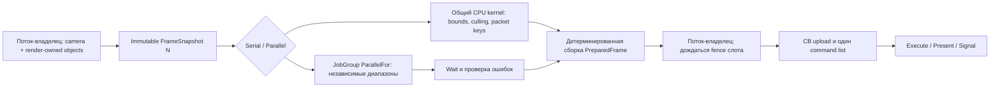

# F3.3 — аудит границы CPU render preparation

19 октября 2026 года. Исследован коммит
`09ca0235708a04ed17751354cea03e125e8fcc79` на `prypiat`.
Это план для согласования; реализация F3.3 не выполнена. Отчёт создан после
единственного коммита F3.2C и оставлен незакоммиченным.

## Главный вывод

`xrRender_R5_DX12` сейчас **не является игровым DX12 renderer**: его vcxproj
собирает static library из CHW12, dx12quarantine, dx12camera и dx12mesh
(`ogsr_engine/Layers/xrRenderPC_R5_DX12/xrRender_R5_DX12.vcxproj:82`).
Единственный обнаруженный ProjectReference на него — xrDX12Smoke.
Нет DX12-реализации IRender_interface, обхода игровых scene objects,
material registry или генерации игровых draw packets.

Игровой `CEngineAPI::Initialize` вызывает AttachRender и выбирает renderer_r4
(`ogsr_engine/xr_3da/EngineAPI.cpp:44`); `XR_3DA.vcxproj:378` ссылается на R4.
`xrRenderPC_R4/xrRender_R4.cpp:8` устанавливает Render = RImplementation.
Поэтому нельзя объявить перенос игрового culling в GR простой заменой цикла
в существующем R5: такого цикла ещё нет. R4 прочитан только как граница
будущего адаптера, его код не менялся и не предлагается переносить целиком.

## Что реально выполняется и кому принадлежит

- **CPU Smoke:** WinMain владеет одним JobSystem (`xrDX12Smoke.cpp:373`),
  `PrepareSceneCPU` использует отдельные синтетические ObjectDesc/ObjectState
  и собственную камеру (`dx12cpuruntime.inl`, `dx12cpuscene.h:43`).
  `PrepareParallel` создаёт группу и ждёт её до возврата
  (`dx12cpuscene.cpp:226`). Эти результаты GPU не потребляет.
- **GPU DX12:** CHW12 владеет SmokeCamera12, SmokeMesh12 и тремя FrameResource.
  `CHW12::RenderFrame:1173` ждёт fence выбранного слота, сбрасывает allocator/list,
  строит ViewProjection, пишет CB и вызывает два Draw: [0,36), [36,72).
  Далее Close → ExecuteCommandLists → Present → Signal → следующий слот.
- **Матрицы:** мировые координаты двух кубов запечены в vertex buffer;
  отдельных world transforms нет. `SmokeCamera12::BuildViewProjection`
  возвращает транспонированную матрицу для HLSL. CPU frustum нужна исходная
  row-vector view*projection, её нельзя извлекать из CB без учёта транспонирования.
- **Ресурсы:** SmokeMesh12 держит ComPtr vertex/upload buffer, root signature,
  PSO; Draw (`dx12mesh.cpp:587`) получает невладеющие cmd и GPU CB address.
  Material handles отсутствуют: один PSO и цвета вершин. CHW12 держит
  per-slot CB, render targets, общий depth, heaps и fence. GPU lifetime
  определяется fence; при неизвестном завершении используется quarantine.

Все пути в предыдущем списке относительны `ogsr_engine/Layers/xrRenderDX12/`.

## Граница с игровой сценой: что нельзя отправлять workers

`CRenderDevice::on_idle` запускает FrameMove/OnCameraUpdated, затем TTAPI
secondary task параллельно render и ждёт его после End
(`ogsr_engine/xr_3da/device.cpp:253–360`). Окончание FrameMove само по себе
не доказывает неизменяемость всех данных во время render.

В R4 `main_pass_dynamic` делает spatial query, сортировку, ROS update, ждёт
обновление секторов, читает visual, изменяет HOM cache и вызывает
`renderable_Render` (`xrRenderPC_R4/r4_R_render.cpp:159–250`). Static traversal
использует изменяемые portal/sector markers. `render_main` уже имеет TTAPI
waiters; dynamic ждёт bones/particles (`r2_R_calculate.cpp:20–87`), а Render
ждёт static/dynamic перед соответствующим потреблением (`r4_R_render.cpp:359`).
Нельзя оборачивать этот обход в ParallelFor или смешивать TTAPI wait с GR
из незарегистрированного потока.

`IRenderable::renderable` содержит mutable Fmatrix и сырые visual/pROS pointers;
деструктор удаляет visual и ROS (`xr_3da/IRenderable.cpp:16`). Проверка
`!g_bRendering` не является владением snapshot или межпоточным барьером.
`dxRender_Visual` хранит shared ref_shader и mutable vis_data
(`Layers/xrRender/FBasicVisual.h:44`); `_MatrixItem` копирует Matrix, но оставляет
сырые pObject/pVisual, `_MatrixItemS` — также ShaderElement*
(`Layers/xrRender/r__dsgraph_types.h:83`). Эти структуры не являются готовым
безопасным snapshot. Потокобезопасность ref_shader здесь не установлена.

## Предлагаемая схема F3.3

Имена Snapshot/PreparedFrame ниже — **новые предлагаемые типы**, не найденные API.

Snapshot копирует camera, bounds, transform, object ID и значения resource IDs;
не содержит IRenderable*, ссылок на mutable camera или указателей mapped CB.
Ресурсы удерживает renderer, IDs проверяются против поколения. Для двух кубов
достаточно неизменяемых индексов и жизни SmokeMesh12; generation registry
нужен перед появлением удаления/streaming, а не фиктивные COM handles в workers.

ParallelFor уместен для bounds transformation, независимого frustum test и
вычисления ключей пакета. JobGroup задаёт lifetime кадра: Wait до merge,
публикации результата или освобождения snapshot. Выход заранее выделен;
worker пишет только свой индекс. Compaction/sort сначала последовательные,
с устойчивым порядком по object ID; порядок прозрачности — отдельный контракт.
Ошибку задачи сначала drain, затем запрет публикации частичного PreparedFrame;
Serial retry допустим лишь на том же живом snapshot после полного drain.

Режим Serial по умолчанию; явный Parallel и Verify используют один kernel,
один snapshot и разные выходные массивы. Существующий JobSystem передаётся
renderer по невладеющей ссылке с оговорённым lifetime, новый pool не создаётся.
Глобальный singleton, CPU affinity и параллельная запись lists не требуются.

## Следующий минимальный milestone: F3.3.0

1. В R5/DX12 добавить CPU-only `RenderSceneSnapshot12` / `PreparedFrame12`
   (предлагаемые `dx12renderprep.h/.cpp`). Описать именно два реально рисуемых
   диапазона SmokeMesh12, world=identity и их фактические bounds. Синтетический
   stress из F3.2C.2 остаётся отдельным тестом, не источником игровых объектов.
2. В SmokeCamera12 получить непротиворечивую пару CPU viewProj и HLSL matrix
   одним snapshot на потоке-владельце. Перед записью команд CHW12 использовать
   serial PreparedFrame вместо двух жёстко заданных Draw, сохранив порядок,
   геометрию, PSO, depth, CB и fence. Для начала culling — только сравнение
   без подавления draw; включение отсечения требует отдельного oracle.
3. Добавить opt-in Parallel/Verify для того же producer через заимствованный
   GR JobSystem; ProjectReference R5→GR появится только в согласованной реализации.
   Сравнивать packet IDs, ranges, matrices, bounds и порядок; два объекта —
   проверка границы CPU→GPU, не демонстрация ускорения.
4. Гейт: Serial/Parallel output equality, прежний depth readback, resize и
   чистый shutdown, отрицательные проверки stale generation и отказа job,
   ручной визуальный осмотр; отдельно задокументировать доступность race detector.
   Замерять snapshot/prep/submit/wait/merge и GPU fence wait раздельно.

## Риски и дальнейшие гейты

- JobGroup::Wait не заменяет GPU fence. CPU snapshot живёт до Wait/merge;
  GPU buffers/CB/allocators — до fence соответствующего слота. Первый milestone
  не вводит CPU frames-in-flight; существующие три GPU-слота сохраняются.
- При будущих асинхронных задачах resize/shutdown сначала прекращают submission
  и дренируют CPU, затем выполняют существующий GPU drain/quarantine. Нынешний
  StopJobs после CHW12::Shutdown допустим лишь потому, что PrepareParallel
  уже дождался задач и они не используют CHW12.
- WM_TIMER в модальном resize вызывает отдельный RenderFrame. Нельзя создавать
  там вторую группу поверх активного кадра; общий вход должен использовать
  завершённый snapshot либо serial preparation с защитой от реентерабельности.
- Перенос игровой сцены требует отдельного DX12 IRender adapter, render-owned
  registry и доказанной точки capture после нужных producers. Это следующий
  согласуемый milestone, не скрытое изменение R4, physics, AI, animation/audio.
- Два объекта не оправдывают worker overhead. Нельзя переносить speedup
  синтетических 16384 объектов на FPS. Race detector и ручной визуальный
  осмотр по результатам F3.2C пока не выполнены.

До согласования этого плана код F3.3 не изменять; command list recording,
ресурсные barriers и queue submission остаются последовательными.
