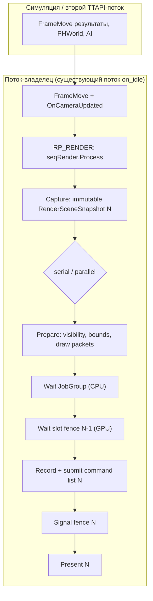
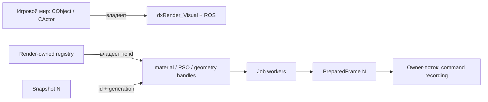
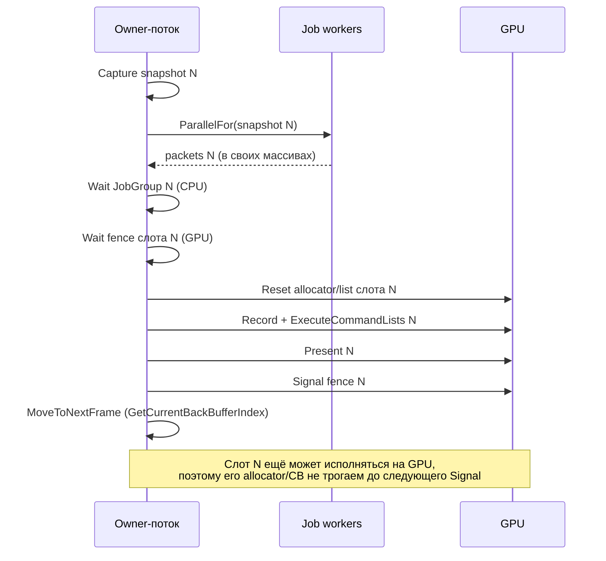

# F3.5.0 — Architecture ADR: multithreaded DX12 renderer foundation

Дата: 2026-10-19. Ветка: `prypiat`.
Статус: **PROPOSED**, согласование. Реализация не начата.
Предшественники: `docs/dx12-f3-3-architecture-audit.md`, `docs/dx12-f3-3-runtime.md`,
`docs/dx12-f2-first-frame.md`, `docs/08-roadmap.md` (раздел F3.5).

## 0. Что решает этот документ

D3D12 позволяет записывать независимые command lists с нескольких CPU-потоков, но
это не делает существующий frame loop X-Ray многопоточным. Нужны явные границы:
где заканчивается игровая симуляция и начинается read-only рендер-подготовка,
кто владеет данными в каждой фазе, и чем синхронизируются CPU-кадр и GPU-кадр.

Документ **не** описывает перенос игровых объектов в DX12 (это F4) и **не**
описывает параллельную запись command lists (это F3.5.3).

## 1. Что установлено о текущем пути (факты)

Проверено чтением кода на `prypiat`, HEAD `5b0e4bbcb`.

### 1.1 Выбор рендерера

- `ogsr_engine/xr_3da/EngineAPI.cpp:49` — `Console->Execute("renderer renderer_r4")`;
  `:46` — `g_current_renderer = 4`.
- `ogsr_engine/xr_3da/xr_3da.vcxproj:378` — ProjectReference только на
  `xrRenderPC_R4`.
- `ogsr_engine/Layers/xrRenderPC_R4/xrRender_R4.cpp:10` — `::Render = &RImplementation`.

Игровой `IRender_interface` для DX12 отсутствует. `xrRender_R5_DX12` — статическая
библиотека из `CHW12`/`dx12quarantine`/`dx12camera`/`dx12mesh`/`dx12renderprep`,
единственный потребитель — standalone `xrDX12Smoke.exe`.

### 1.2 Потоковая модель

Единственный поток выполнения кадра — поток `CRenderDevice::on_idle`
(`ogsr_engine/xr_3da/device.cpp:212`):

| Место | Что происходит |
|---|---|
| `device.cpp:253` | `FrameMove()` |
| `device.cpp:263` | `OnCameraUpdated(false)` |
| `device.cpp:268` | `TTAPI->submit(...)` — вторичный поток: `g_sound_update.OnFrame()`, `seqParallel`, `seqFrameMT.Process(rp_Frame)` (PHWorld + NetProcessor), опционально `script_gc()` |
| `device.cpp:312–318` | `Begin()` → `seqRender.Process(rp_Render)` — рендер |
| `device.cpp:327` | `End()` |

`g_bRendering` (`device.cpp:22`) — обычный `BOOL`: выставляется `TRUE` в
`::Render->Begin()` (`:53`) и `FALSE` в `End()` (`:93`). Это **не** ownership и
**не** межпоточный барьер.

Внутри фазы рендера уже есть собственная схема producer/consumer на TTAPI:

- `r2_R_calculate.cpp:21` `calculate_static()` — `TTAPI->submit(...)`,
  внутри `RImplementation.main_pass_static(dsgraph_main)`, `dsgraph_main.marker++`.
- `r2_R_calculate.cpp:50` `calculate_dynamic()` — `TTAPI->submit(...)`,
  ждёт `calculate_particles_wait()` и `calculate_bones_wait()`, затем
  `main_pass_dynamic(dsgraph_main, true)`.
- `r4_R_render.cpp:359–369` — `ensure_calculate_static(); wait_static();
  calculate_dynamic(); ...; wait_dynamic();` перед потреблением dsgraph.

Вывод: в X-Ray **уже есть** модель «посчитать в worker, подождать, отрендерить».
Переиспользовать её нельзя as-is, потому что producer пишет в общее состояние.

### 1.3 Где игровые объекты превращаются в draw packets

`R_dsgraph_structure::build` (`r__dsgraph_build.cpp:763`) вызывает
`renderable->renderable_Render(context_id, renderable)` — чисто виртуальный метод
`IRenderable` (`IRenderable.h:26`), реализуется в `xrGame` (например
`CActor::renderable_Render`, `Actor.cpp:1199`; `CAI_Crow::renderable_Render`,
`ai_crow.cpp:314`). Там объект добавляется в `mapMatrixPasses` dsgraph.

Параллельный путь — `CRender::main_pass_dynamic` (`r4_R_render.cpp:158`), который
делает пространственный запрос (`:164`), сортировку (`:167`), обновляет ROS
текущей сущности (`:175–190`), ждёт `update_sectors_awaiter` (`:198`), обходит
`lstRenderables` (`:201`) и на `:250` вызывает тот же `renderable_Render`.

### 1.4 Опасное изменяемое состояние

| Что | Где | Почему опасно |
|---|---|---|
| `Fmatrix xform` + `IRenderVisual* visual` + `IRender_ObjectSpecific* pROS` | `IRenderable.h:11–19` | raw pointers на объекты, живущие в игровом мире; владение не при рендере |
| Деструктор удаляет visual и ROS | `IRenderable.cpp:16` — `VERIFY(!g_bRendering); model_Delete(visual); ros_destroy(pROS);` | удаление во время render-фазы = use-after-free |
| `vis_data vis` + `getVisData()` | `FBasicVisual.h:74`, `:96` | читается и пишется в build-фазе (`r__dsgraph_build.cpp:733`, `r4_R_render.cpp:214–222`) — HOM-кэш мутируется на каждом кадре |
| `ref_shader shader` | `FBasicVisual.h:44` | shared-ресурс; потокобезопасность не установлена |
| `CSector::r_marker`, `CPortal::r_marker` | `r__sector.h:94`, `:39` | изменяемые маркеры portal-обхода, читаются в build-фазе (`r4_R_render.cpp:236`, `r__dsgraph_build.cpp:752`) |
| `PortalTraverser.marker()/frame()` | `r4_R_render.cpp:232`, `:236` | сравнение с `Device.dwFrame` — кадровое состояние, не локальное |
| `_MatrixItem.pObject/pVisual` | `r__dsgraph_types.h:83` | копия `Fmatrix Matrix` есть, но сырые указатели остаются |
| `_MatrixItemS.pObject/pVisual/se` | `r__dsgraph_types.h:96` | дополнительно сырой `ShaderElement*` |

## 2. Потоковая модель DX12-рендерера

Правила:

1. **Один поток-владелец кадра.** Как сейчас: `on_idle`. Никаких новых потоков
   записи command lists на этом этапе (F3.5.3 — позже).
2. **Snapshot неизменяем** после capture: у него нет изменяющего API и внешних
   ссылок. `RenderSceneSnapshot12` из F3.3 — образец, но он собран вручную из двух
   кубов; здесь он собирается из реального обхода.
3. **Worker'ы не пишут в игровое состояние.** Ни `vis_data`, ни `r_marker`, ни
   `pROS`. Только в заранее выделенные элементы своих выходных массивов.
4. **Порядок фиксирован.** Порядок draw из snapshot сохраняется; compaction/sort —
   последовательные, устойчивые по object id.

## 3. Граница snapshot

Единственная допустимая точка capture — **после** завершения фазы, которая
построила полный набор видимых объектов, и **до** записи команд. В текущей
архитектуре это граница между `wait_dynamic()` и `r_dsgraph_render_graph_*`
(`r4_R_render.cpp:359–369`).

Причина: `main_pass_dynamic` мутирует `vis_data`, `r_marker` и ROS, поэтому до его
завершения snapshot был бы несогласованным. После завершения — кадр больше не
меняется на потоке-владельце.

### 3.1 Почему `wait_dynamic()` не доказывает стабильность входных данных

`wait_dynamic()` (`r2_R_calculate.cpp:50` → `render_main::wait_dynamic`) присоединяет
**только** TTAPI-задачу, отправленную функцией `calculate_dynamic()`. Это не
единственная параллельная работа кадра.

Вторичная TTAPI-задача отправляется в `CRenderDevice::on_idle`
(`device.cpp:268`) и присоединяется **в конце кадра**, после `End()`:

| Место | Событие |
|---|---|
| `device.cpp:268` | `auto awaiter = TTAPI->submit([this]{...})` |
| `device.cpp:318` | `seqRender.Process(rp_Render)` — фаза рендера |
| `device.cpp:349` | `ZoneScopedN("WaitSecondThread")` |
| `device.cpp:360` | `awaiter.wait()` |
| `device.cpp:365` | `second_tasks.back().wait()` |

То есть вторичный поток (`g_sound_update.OnFrame()`, `seqParallel`,
`seqFrameMT.Process(rp_Frame)` — PHWorld и NetProcessor, опционально `script_gc()`)
выполняется **параллельно всей фазе рендера**, а `g_bRendering` — обычный `BOOL`
(`device.cpp:22`, выставляется `:53` и снимается `:93`), а не барьер.

Следствие: `wait_dynamic()` гарантирует стабильность только относительно задачи
`calculate_dynamic()`. Относительно вторичного TTAPI-потока стабильность входных
данных snapshot надо **доказывать отдельно**. Варианты:

1. **Аудит данных по полям.** Для каждого поля snapshot перечислить всех писателей и
   показать, что ни один из них не находится во вторичной TTAPI-задаче. Это
   единственный вариант, не меняющий текущий frame pacing.
2. **Явный join перед capture.** Присоединить вторичную задачу до снятия snapshot.
   Доказывает стабильность, но меняет pacing и требует замеров до/после.
3. **Сужение входного набора.** Снимать snapshot только с данных, записанных до
   `TTAPI->submit` (`device.cpp:268`), то есть произведённых `FrameMove`/`OnCameraUpdated`.

Что считается доказательством стабильности:

- перечень полей snapshot и перечень писателей каждого поля (файл:строка);
- для каждого писателя — подтверждение, что он не выполняется во вторичной
  TTAPI-задаче и не в GR-задачах;
- проверка на инструментированной сборке: запись во входное поле во время
  фазы рендера детектируется и приводит к падению теста;
- при выборе варианта 2 — замеры frame time до и после, без регресса.

Без этого доказательства корректность snapshot не заявляется.

Snapshot содержит **только значения и идентификаторы**, не указатели на игровые
сущности:

| Поле | Тип | Комментарий |
|---|---|---|
| object id | `u64` | стабильный идентификатор на время жизни объекта |
| generation | `u64` | поколение сцены для отбраковки устаревших кадров |
| transform | `Fmatrix` | копия |
| bounds | min/max `Fvector3` | в мировых координатах |
| visual id | `u32` | render-owned идентификатор ресурса |
| visual generation | `u32` | поколение registry для того же идентификатора |
| material / PSO id | `u32` | render-owned идентификатор + поколение |
| flags | `u32` | hud/invisible/прозрачность |

НЕ входит: `IRenderable*`, `IRenderVisual*`, `pROS`, `ShaderElement*`,
`vis_data*`, mapped GPU-память.

**Идентификаторы — только render-owned.** Приведение `ShaderElement*` к целому
запрещено: адрес может быть переиспользован после удаления элемента, а значение
не несёт информации о поколении. Каждый идентификатор сопровождается поколением
registry; пара `(id, generation)` однозначна и отличает «тот же элемент» от
«другой элемент по тому же адресу».

Пока registry не реализован, в тестах используются **синтетические** идентификаторы
из фиксированной таблицы (как в F3.2C.2) с синтетическими поколениями. Это
проверяет механику передачи и отбраковки, но **не** проверяет разрешение реальных
ресурсов: для этого нужен настоящий registry.

## 4. Ownership игровых render objects

Правила владения:

1. **Игровой мир владеет `IRenderable`, `dxRender_Visual`, `pROS`** — как сейчас.
   Render не владеет ими и не удаляет их.
2. **Render владеет registry ресурсов** (visual id → material/PSO/geometry) и
   жизненным циклом GPU-ресурсов. Registry — отдельная сущность с поколениями.
3. **Snapshot владеет своими копиями.** Срок жизни — до последнего потребителя
   (JobGroup wait либо публикация результата), не дольше.
4. **PreparedFrame владеет своими draw packets.** Передаётся по значению;
   частичный кадр не публикуется.
5. **Удаление игрового объекта** должно быть видно render-стороне через generation,
   а не через «указатель стал невалидным». В F3.3 проверка stale generation уже
   реализована и покрыта юнит-тестом; здесь она становится обязательной для
   реальной сцены.
6. **`pROS` не попадает в worker'ы.** `IRender_ObjectSpecific` живёт в игровом
   мире и обновляется на потоке-владельце (см. `r4_R_render.cpp:175–190`).

## 5. Frame scheduling: N / N+1

Инварианты:

1. **CPU JobGroup::Wait и GPU fence — независимые механизмы.** Wait защищает
   память CPU-выхода; fence — повторное использование allocator/list слота.
2. **Количество GPU-слотов** — 3 (как в `CHW12`), frames-in-flight ограничен.
3. **Backpressure**: если слот ещё занят, поток-владелец ждёт его fence перед
   `Reset()`. Новые кадры не ставятся в очередь сверх лимита.
4. **Snapshot живёт не дольше кадра.** Никаких CPU-кадров in-flight, кроме как
   внутри одного `RenderFrame`.
5. **Resize и shutdown** сначала прекращают submission, затем дренируют CPU
   (JobGroup wait), затем GPU (drain/quarantine) — существующий порядок
   `CHW12::Resize` и `CHW12::Shutdown` сохраняется.

### 5.1 Фактический GPU timeline в `CHW12` (проверено по коду)

Порядок в `CHW12::RenderFrame` именно такой, и он существенен:

| Место | Действие |
|---|---|
| `CHW12.cpp:1400` | `m_commandQueue->ExecuteCommandLists(1, lists)` |
| `CHW12.cpp:1405` | `m_swapChain->Present(1, 0)` |
| `CHW12.cpp:1424` | `frame.fenceValue = ++m_fenceValue` |
| `CHW12.cpp:1425` | `m_commandQueue->Signal(m_fence, frame.fenceValue)` |
| `CHW12.cpp:1436` / `:1441` | `MoveToNextFrame()` → `CHW12.cpp:1108` `m_frameIndex = m_swapChain->GetCurrentBackBufferIndex()` |
| `CHW12.cpp:1235` | `if (frame.fenceValue != 0)` |
| `CHW12.cpp:1241` | `WaitForFenceValue(frame.fenceValue, ...)` |
| `CHW12.cpp:1253` | `frame.commandAllocator->Reset()` |
| `CHW12.cpp:1262` | `cmd->Reset(frame.commandAllocator.Get(), nullptr)` |

Следствия, которые обязан сохранять перенос:

1. **`Present` предшествует `Signal`.** Fence-значение слота сигналится после
   Present, поэтому оно покрывает и command list, и Present этого слота.
2. **Ожидание — перед `Reset`.** `WaitForFenceValue` (`:1241`) происходит до
   `commandAllocator->Reset()` (`:1253`) и `cmd->Reset()` (`:1262`). Это и есть
   защита повторного использования слота: пока GPU не завершил слот, аллокатор и
   command list не сбрасываются.
3. **`m_frameIndex` берётся у swapchain в конце кадра** (`MoveToNextFrame`), поэтому
   в начале следующего кадра слот — это back buffer, выбранный последним Present.
   Ожидается fence-значение, которое было сигналится, когда этот же слот
   использовался в предыдущий раз (до 3 кадров назад).
4. **Окклюзия не ломает ротацию слотов.** `MoveToNextFrame()` вызывается и на
   occlusion-пути (`:1436`), иначе слот завис бы навсегда.
5. **Провал `Signal` неявно останавливает рендер**: аллокатор не сбрасывается в
   следующем кадре, поэтому запись не продолжается.
6. **`m_fenceValue` растёт на каждый сигнал**, а `frame.fenceValue` хранит
   последнее значение для слота — сравнение «занят ли слот» основано на нём.

## 6. CPU/GPU synchronization

| Событие | Механизм | Что защищает |
|---|---|---|
| Worker → поток-владелец | `JobGroup::Wait()` | CPU-выходные массивы кадра |
| Поток-владелец → GPU | `ExecuteCommandLists` + `Present` + `Signal(fence)` | порядок команд и момент освобождения слота |
| GPU → поток-владелец | `WaitForFenceValue(slot)` **до** `Reset` | повторное использование allocator/list/CB слота |
| Удаление GPU-ресурса | fence + quarantine | use-after-free при неизвестном завершении |

Запрещено:

- ждать GPU fence изнутри GR-задачи;
- сбрасывать allocator слота, не дождавшись его fence;
- смешивать TTAPI wait и GR `JobGroup::Wait` в одном месте без явного порядка;
- вызывать lifecycle JobSystem из callback.

## 7. Resource lifetime

1. **Per-slot** (3 слота): command allocator, command list, per-slot constant buffer.
   Reset только после fence слота.
2. **Transient upload/descriptor**: переиспользование только после завершения GPU;
   в F3.5 — последовательно на потоке-владельце.
3. **Render-owned registry** (visual/material/PSO): время жизни — пока жив рендерер
   либо пока объект не удалён через generation. Удаление — отложенное, до завершения
   всех слотов, которые могли использовать handle.
4. **Карантин** при неизвестном завершении GPU — существующий
   `GpuLifetime` / `QuarantineGpuResources` в `CHW12` сохраняется без изменений.
5. **PSO/material handles** в snapshot — значения, а не указатели; render-сторона
   разрешает их в объекты только на потоке-владельце.

## 8. Безопасный переход R4 → DX12 без изменения DX11

Принцип: **DX11 не меняется**. Переключение — через сборку/флаг, а не через
пользовательские опции (правило F из roadmap).

Варианты и выбор:

| Вариант | Оценка |
|---|---|
| A. Подмена `CHW` на D3D12 в одном коммите | **Отклонён**: DX12 требует явных barriers, descriptors, PSO; подмена `ID3D11DeviceContext` ссылками на command list запрещена |
| B. Отдельная build-конфигурация DX12 + отдельный рендерер | **Принят** как целевая форма: `xrRenderPC_R5_DX12` уже существует как статическая библиотека, `Engine.sln` содержит оба проекта |
| C. Временный DX12 harness (standalone) | **Уже используется**: `xrDX12Smoke.exe` — место для проверки границ до переноса кадра |

Переход выполняется поэтапно, без одновременной правки DX11:

1. **F3.5.1–F3.5.2** — snapshot и декомпозиция на изолированной сцене-представителе
   (как в F3.3), плюс отдельный тест с реальными полями структур X-Ray.
2. **F3.5.3** — multi-list prototype, всё ещё без переноса игрового кадра.
3. **F4** — перенос игрового кадра: `CEngineAPI` получает выбор рендерера, DX11-путь
   остаётся дефолтным и неизменным; DX12 включается флагом сборки.

Критично: `CEngineAPI::Initialize` (`EngineAPI.cpp:49`) и `XR_3DA.vcxproj:378`
— единственные точки выбора. Их изменение должно сохранять `renderer_r4` по
умолчанию.

## 9. Минимальный следующий шаг (F3.5.1 — representative snapshot prototype)

F3.5.1 — это **representative snapshot prototype**, а не интеграция реальных
игровых объектов. Реальный обход игровой сцены остаётся за F4.

Назначение шага: проверить механику snapshot → packets на **представительном**
наборе полей X-Ray, не изменяя DX11 и не подключая `main_pass_dynamic`.

1. **Расширить `RenderSceneSnapshot12`** до представительного набора полей
   X-Ray: `Fmatrix`, bounds, `vis_data`-эквивалент (sphere + hom frame),
   render-owned `(id, generation)` вместо любых указателей, флаги hud/invisible.
   Источник — таблица, построенная из структур `IRenderable`/`dxRender_Visual`
   (как сейчас строится CPU-сцена из фиксированного seed в F3.2C.2), а не реальный
   обход.
2. **Собрать draw packets** через существующий `Prepare()`/`Kernel()` без изменения
   сигнатуры; добавить в kernel проверку флагов hud/invisible и прозрачности, а
   также отбраковку по `(id, generation)`.
3. **Гейт**: serial/parallel/verify совпадают; depth/hash прежние; resize прежний;
   отрицательные проверки stale generation и отказа JobSystem; 0 validation errors.

Что этот шаг **не** делает: не трогает R4, не подключает реальный
`main_pass_dynamic`, не переносит `renderable_Render`, не создаёт render-owned
registry ресурсов (в тестах — синтетические идентификаторы).

## 10. Риски и зависимости

### Риски

| Риск | Последствие | Митигация |
|---|---|---|
| Реальный обход объектов нельзя безопасно параллелить из-за `vis_data`, `r_marker`, ROS | Попытка ускориться даст гонки, не выигрыш | Snapshot только после `wait_dynamic()`; worker'ы не читают мутируемое состояние |
| **Вторичная TTAPI-задача параллельна фазе рендера** | Snapshot читает данные, которые ещё пишутся: несогласованность, гонки | Доказательство стабильности по полям (раздел 3.1) либо явный join перед capture с замерами; без доказательства корректность не заявляется |
| `ref_shader` может оказаться не thread-safe | порча состояния при параллельном доступе | В F3.5 доступ к `ref_shader` только на потоке-владельце; в snapshot — render-owned id |
| Удаление игрового объекта во время кадра | use-after-free, если указатель попал в worker | `(id, generation)` registry + отложенное удаление |
| Приведение указателей ресурсов к целым | коллизия адресов после удаления, ложная идентичность | Запрещено: только render-owned `(id, generation)` |
| Появление второго планировщика задач рядом с TTAPI | дублирование, непредсказуемость | Один общий пул (GR), TTAPI остаётся для simulation; запрещено блокировать realtime-потоки |
| Ожидание GPU fence из GR-задачи | дедлок | Запрещено контрактом JobGroup |
| Потеря порядка Present → Signal при переносе | слот может быть переиспользован до завершения Present | Порядок зафиксирован в разделе 5.1 и обязан сохраняться |
| Поспешный перенос игрового кадра | регресс DX11 | Перенос только после гейтов F3.5.1–F3.5.4; DX11 остаётся дефолтом |
| Отсутствие замеров до параллельной записи | параллельность без выгоды | F3.5.4 требует профили до решения |

### Зависимости

- F3.3 (snapshot/prepared packets) — реализован, коммит `5b0e4bbcb`.
- F3.2C.2 (CPU scene pipeline, измерения serial/parallel) — реализован.
- GR Job System (`ogsr_engine/Layers/JobSystem`) — один пул, OS Default,
  serial fallback.
- Существующий `xrRender_R5_DX12` и `xrDX12Smoke` — место для прототипа.
- Не зависит от: World Streaming (I/J), DXR (G), H.

## 11. Критерии приёмки F3.5.0

| Критерий | Проверяемый результат |
|---|---|
| ADR с диаграммой | Frame N/N+1, потоковая модель, fencing/lifetime инварианты |
| Список опасных mutable pointers | Перечислены с указанием файла и роли (раздел 1.4) |
| Границы выбраны | Snapshot, draw packets, PSO/material handles, queue submission, fallback |
| **Синхронизация с TTAPI** | Раздел 3.1: доказательство стабильности входных данных либо явный join с замерами |
| **Идентификаторы ресурсов** | Только render-owned `(id, generation)`; приведение указателей к целым отсутствует |
| **GPU timeline сверен** | Порядок Present → Signal и ожидание fence переиспользуемого слота описаны по факту (раздел 5.1) |
| **F3.5.1 — прототип** | Явно обозначен как representative snapshot prototype, не интеграция игровых объектов |
| DX11 не изменён | Дифф по `xrRenderPC_R4`, `xrRender_R4.cpp`, `EngineAPI.cpp` отсутствует |
| Реализация не начата | Ни одного изменения игрового обхода |
| Риски и критерии | Зафиксированы до кода |

Критерии F3.5.1–F3.5.4 остаются как в `docs/08-roadmap.md` и в этом документе не
переопределяются.

## 12. Что явно не входит в F3.5.0

- Реализация игрового `IRender_interface` для DX12.
- Параллельная запись D3D12 command lists.
- Перенос `renderable_Render`, `main_pass_dynamic`, `main_pass_static`.
- Изменение DX11/R4.
- World Streaming (I/J), DXR (G), аудит многопоточности движка (H).
